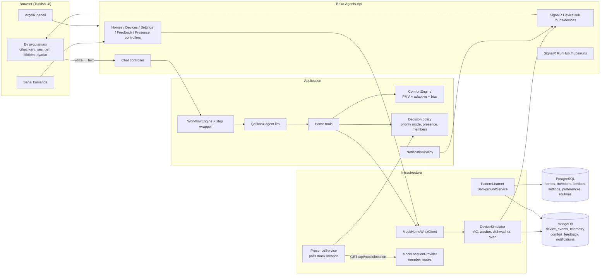

# Project document — Çeliknaz AI Assistant

Status: **draft, waiting for approval**. Date: 2026-11-03. Owner: lead.

Companion to [Proposal.md](Proposal.md) (platform architecture) and [Phases.md](Phases.md) (Phase 7: plug in the real problem). This document describes the real hackathon problem and how we build it **on top of the platform without changing its core**. API shapes here are proposals; after approval they move into `docs/architecture/contracts.md`.

---

## 1. Summary

**Çeliknaz** is a voice-first assistant inside a **HomeWhiz-compatible Arçelik/Beko home app**. The home already contains the family's connected Beko products (air conditioner, washing machine, dishwasher, oven, ...). The user sees all of them, manages them from the app, and can tap one button to talk to Çeliknaz: *"Ev soğudu, biraz ısıt"*, *"Evden çıkıyorum, ekonomik modda ılık tut"*, *"Bulaşık makinesini gece ucuz saatte çalıştır"*.

Çeliknaz manages the products through tools, **learns each household member's comfort and habits from their behaviour and feedback**, and **distributes household tasks among members** (e.g. "çamaşır bitti, Mehmet evde, asmayı ona verdim"). Its first priority is **saving energy and cost**, within the comfort level the user picks.

Depth per product (to stay within hackathon time):
- **Air conditioner: deep.** Comfort engine (temperature, humidity, clothing, season), pattern learning, presence-based setback. This is the core of the demo.
- **Other products: standard.** State, start/stop/program, finish events, energy use, cheap-hour scheduling, household tasks triggered by their events.

Two surfaces:

1. **Consumer app** (HomeWhiz-like, mobile-first): all products of the home, device detail and control, voice button, comfort feedback, household tasks, settings, notifications.
2. **Arçelik dashboard**: usage metrics, comfort/learning metrics, energy saved, LLM cost, server cost, scale projection. Built on the existing governance dashboard + Grafana.

Data flow:

```text
read:     products (sensors, state) → HomeWhiz (mock) → PostgreSQL + MongoDB → comfort engine / pattern learner → Çeliknaz (LLM)
command:  Çeliknaz or app → tool / API → HomeWhiz command API (mock) → product (simulator) → new state → UI (SignalR)
```

## 2. Jury criteria mapping

| Criterion | What we show |
|---|---|
| 1. User-centric impact | One app and one voice for every Beko product at home; it learns *your* comfort (clothing, sensitivity, routines); fair household task sharing; fewer manual corrections over time; notification amount is the user's choice |
| 2. Agent effectiveness | Deterministic comfort engine + LLM for language only; bounded tools; evaluation set (intents, tool use, multi-member conflicts); override rate and "İyi" feedback rate trending the right way |
| 3. Innovation | Standard thermal comfort model (PMV + adaptive) driven by AC sensors, humidity-aware "dry before cool", implicit feedback from the physical remote, presence-aware setback and pre-conditioning, household conflict resolution |
| 4. Business value | Fits directly into HomeWhiz / Beko's existing apps; energy and TL saved per home (comfort + cheap-hour shifting), extrapolated to the HomeWhiz fleet; LLM + server cost per active user and per conversation; projection for N users; capability-based device model, so a new Beko product is configuration, not a rewrite |
| 5. AI safety and trust | Every decision traced (span + Mongo + reason), hard bounds in tools, confirmation for disruptive actions, guardrails, location minimisation (KVKK), "reset what you learned" button, full audit of who/what changed the device |

## 3. Scope

**In scope (hackathon)**
- One home with multiple household members and its Beko products: AC in the living room and bedroom, washing machine, dishwasher, oven (fridge optional, read-only).
- Mock HomeWhiz API and product simulators: AC with simple thermal physics (temperature, humidity, power draw); washer/dishwasher/oven with programs, remaining time, finish events and energy.
- Mock location endpoint for household members (Section 12).
- Çeliknaz agent with device, comfort, preference, presence, task, feedback and settings tools.
- Comfort engine, pattern learner, presence/geofence logic, household task distribution, notification policy.
- Voice in the browser (Web Speech API, `tr-TR`).
- Consumer UI + Arçelik dashboard extensions.
- Synthetic history generator (personas) so learning is visible in the demo.

**Out of scope**
- Real HomeWhiz / device integration, real push notifications (FCM/APNs), native mobile apps, ML model training, multi-home accounts.

**Assumptions**
- The app behaves like HomeWhiz: the home and its products already exist (seeded); we do not build device pairing.
- Indoor temperature and humidity come from the AC's own sensors (simulated); a room reading like **24.8 °C** is the current room temperature.
- Member locations come from a mock endpoint (no real GPS needed for the demo).
- Outdoor weather is mocked (seasonal curves per city), optionally replaceable with a free weather API later.
- Products are modelled as `type + capabilities`, so adding a product type means configuration plus a small simulator, not new agent logic.

## 4. Architecture

Nothing in the platform core changes. We add a **Home domain** (homes, members, devices), a **device simulator**, a **comfort engine**, a **pattern learner** and new **tools**; Çeliknaz is an agent record + workflow in Postgres like any other.



## 5. Domain model

| Entity | Key fields |
|---|---|
| `Home` | id, name, city, location (lat/lng, stored once), geofence radius, conflict policy, timezone |
| `HouseholdMember` | id, home_id, user_id (nullable for members without login), display name, role (`owner` / `member` / `guest`), is_default |
| `Device` | id, home_id, room, type (`air_conditioner` / `washing_machine` / `dishwasher` / `oven` / `refrigerator`), brand/model (display), capabilities (JSON: commands, modes/programs, ranges, sensors), assigned_member_id (nullable) |
| `DeviceState` | common: power, status (`idle` / `running` / `paused` / `finished` / `error`), power_w, updated_at; type-specific JSON: AC → setpoint, mode (`cool` / `heat` / `dry` / `fan` / `auto` / `eco`), fan, room_temp, humidity; washer/dishwasher → program, remaining_min, door; oven → mode, target_temp, current_temp, timer |
| `HouseholdTask` | id, home_id, title, origin (`device_event` / `routine` / `manual` / `voice`), device_id (nullable), assigned_member_id, due_at, status (`open` / `done` / `skipped`), effort points |
| `TaskRule` | home_id, trigger (e.g. `washing_machine.finished`), task template ("Çamaşırları as"), distribution strategy, enabled |
| `MemberSettings` | priority mode, notification level, quiet hours, default clothing, thermal sensitivity offset (learned), location sharing on/off |
| `ComfortProfile` | per member and context bucket: preferred setpoint (weighted median), bias, confidence |
| `Routine` | member, action, day type, time ± window, confidence, status (`detected` / `suggested` / `accepted` / `rejected`) |

## 6. Mock HomeWhiz and device simulator

The goal of the mock: behave like HomeWhiz so that **our app pulls the home, its rooms and all Beko products with GET calls**, exactly as it would from the real HomeWhiz later. Our backend talks to it only through an `IHomeWhizClient` interface with an HTTP implementation and `HomeWhiz__BaseUrl` in configuration. Today the base URL points to the mock endpoints in our own backend (`/api/mock/homewhiz`); switching to the real HomeWhiz is a configuration and client change, not an app change.

### Mock home (seeded)

One home, rooms assigned, products per room:

| Room (oda) | Beko products |
|---|---|
| Salon | Klima (salon) |
| Yatak odası | Klima (yatak odası) |
| Çocuk odası | Klima (çocuk odası) (optional) |
| Mutfak | Bulaşık makinesi, Fırın, Buzdolabı (read-only, optional) |
| Banyo / çamaşır odası | Çamaşır makinesi |

Members: Ayşe (owner, default), Mehmet, Zeynep (child, can use the app with limited rights). Each product has a realistic Beko-style display name and model code (fictional), capabilities and an initial state (e.g. salon room temperature 24.8 °C, 55 % humidity).

### Mock HomeWhiz endpoints (GET for reading)

| Method + path | Returns |
|---|---|
| `GET /api/mock/homewhiz/homes` | homes of the user |
| `GET /api/mock/homewhiz/homes/{homeId}` | home with rooms and members |
| `GET /api/mock/homewhiz/homes/{homeId}/rooms` | rooms with their product ids |
| `GET /api/mock/homewhiz/homes/{homeId}/appliances` | all Beko products with type, room, capabilities, current state |
| `GET /api/mock/homewhiz/appliances/{applianceId}` | one product with current state |
| `GET /api/mock/homewhiz/appliances/{applianceId}/telemetry?from&to` | sensor and energy series |
| `POST /api/mock/homewhiz/appliances/{applianceId}/commands` | the only write: command to the product (simulator applies it) |

Our app API (`/api/homes/me`, `/api/devices/...`) sits in front of this: it reads through `IHomeWhizClient`, adds our own data (settings, comfort, tasks), and writes every change to Mongo with `source` and `trace_id`. Çeliknaz's tools also go through `IHomeWhizClient`, never to the simulator directly.

### Simulator
- `DeviceSimulator` (`BackgroundService`) ticks every few seconds, with one small simulator per product type behind a common interface:
  - **AC**: room temperature moves toward the setpoint when running and toward outdoor temperature when off; `dry` lowers humidity; power draw depends on mode and the gap to the setpoint.
  - **Washing machine / dishwasher**: a started program counts down, draws power per program profile, then emits `finished` (which can create a household task).
  - **Oven**: heats toward the target temperature, emits `preheated` and `timer_done`.
  - **Refrigerator** (optional): read-only temperature and door-open alerts.
- **Simulated clock** with a configurable speed (`Simulation__TimeScale`, e.g. 60× for the demo) so "20 minutes later" and day cycles happen in seconds on stage.
- Every state change → Mongo `device_events` (with `source`) and SignalR `DeviceStateChanged`. Telemetry samples → Mongo `device_telemetry` (downsampled).

### Proposed endpoints (go to `contracts.md` after approval)

| Method + path | Purpose |
|---|---|
| `GET /api/homes/me` | home, members, all products with current state |
| `GET /api/devices/{id}/state` | current state |
| `POST /api/devices/{id}/commands` | `{ "type": "<command from the device's capabilities, e.g. power, setpoint, mode, fan, start_program, pause, set_oven>", "value": ..., "source": "app\|remote\|voice\|ai\|schedule", "memberId": "..." }` → `202 { commandId, accepted, state }` or `422` (not supported / out of bounds) |
| `GET /api/mock/location?memberId=` | **mock location provider**: `{ memberId, lat, lng, timestampUtc }` from a scripted route per member (Section 12) |
| `PUT /api/mock/location/{memberId}/route` | demo control: choose a route/scenario (`at_home`, `commute_out`, `commute_back`) |
| `GET /api/homes/me/tasks`, `POST /api/tasks/{id}/done\|skip\|reassign` | household tasks |
| `GET /api/homes/me/task-rules`, `PUT /api/homes/me/task-rules/{id}` | configurable task rules and distribution strategy |
| `GET /api/devices/{id}/telemetry?from&to` | temperature, humidity, power series |
| `GET /api/me/settings` / `PUT /api/me/settings` | priority mode, notification level, quiet hours, clothing, location sharing |
| `POST /api/me/comfort-feedback` | `{ deviceId, sensation: -1\|0\|1, clothing?, commandId? }` |
| `POST /api/me/presence` | `{ state: "leaving\|arriving" }` (spoken or tapped); location-based presence comes from the mock location provider; only distance bands are stored |
| `GET /api/me/routines`, `POST /api/me/routines/{id}/accept\|reject` | learned routines and suggestions |
| `GET /api/me/notifications`, `POST /api/me/notifications/{id}/read` | notification center |
| `DELETE /api/me/learning` | "Öğrendiklerini sıfırla" |
| `GET /api/dashboard/home-usage`, `/energy`, `/comfort`, `/unit-costs` | Arçelik dashboard queries |

SignalR `DeviceHub` (`/hubs/devices`, group per home): `DeviceStateChanged`, `DeviceEvent` (finished, preheated, ...), `TaskAssigned`, `NotificationCreated`, `ComfortCheckRequested`.

The **virtual remote** in the UI calls the same command endpoint with `source: "remote"`. That is how implicit feedback reaches the system.

## 7. Çeliknaz agent

- Model `claude-sonnet-5-5`; Haiku for guardrails and the weekly habit summary.
- Instructions: Turkish, short spoken-style answers (they are read aloud); always state what changed and the cost effect; never exceed device bounds; ask before disruptive actions (turning off while someone is home, overriding another member's setting, starting the oven remotely); allowed topics = the home's Beko products, comfort, energy, household tasks.
- Workflow (data, as usual): `trigger.user_message → guard.input → agent.llm (tools) → guard.output → respond`.
- The LLM **does not compute comfort or patterns**. It understands the request, calls tools, and explains the result. This keeps cost low and every decision reproducible.

### Tools

| Tool | What it does |
|---|---|
| `get_home_status` | members present, all products and their states, outdoor weather, active priority mode |
| `control_device` | any command the product's capabilities allow (AC power/setpoint/mode/fan, washer/dishwasher start/pause/program, oven mode/temperature/timer); bounds and capabilities enforced inside the tool |
| `find_cheapest_time` | cheapest start time for a washer/dishwasher program before a deadline (time-of-use tariff) |
| `list_tasks` / `assign_task` / `create_task` | household tasks: see, create ("akşama fırını temizlemek lazım"), assign or rebalance |
| `get_comfort_assessment` | for a device + present members: PMV/feeling, recommended action (cheapest first), estimated cost per hour/day for each option |
| `report_thermal_sensation` | records "üşüdüm / terledim / iyi" and clothing ("kalın giydim") for a member |
| `get_member_profile` | preferred setpoints by context, sensitivity offset, routines |
| `propose_automation` | creates a routine suggestion; becomes a schedule only after the user accepts |
| `schedule_action` | one-off or recurring action ("17:30'da soğutmaya başla") |
| `set_presence` | "evden çıkıyorum / eve geliyorum" from speech |
| `get_settings` / `update_settings` | priority mode, notification level, quiet hours |
| `estimate_energy` | kWh and TL for a plan vs. the user's usual behaviour |

Optional subagent (shows the platform's subagent feature): **"Enerji Danışmanı"**, which answers "bu ay ne kadar harcadım, nasıl azaltırım?" from telemetry and `EnergyOptions`.

## 8. Comfort engine

Deterministic C# component in Application. Unit-tested against ISO 7730 reference values.

**Inputs → model**
- **PMV/PPD (ISO 7730 / ASHRAE 55)**: air temperature and humidity (AC sensors), air speed (from fan level), mean radiant temperature (≈ air temperature), clothing insulation (clo), metabolic rate (met). Output: predicted feeling from −3 (cold) to +3 (hot).
- **Clothing (clo)**: season default (summer ≈ 0.5, winter indoor ≈ 1.0), overridden when the member says so ("kalın kazak giydim" → higher clo) or taps a chip in the UI (İnce / Normal / Kalın).
- **Activity (met)**: by time of day (sleep ≈ 0.7, seated ≈ 1.0, light activity ≈ 1.2).
- **Season**: ASHRAE 55 adaptive model, `T_comfort ≈ 0.31 × T_outdoor_mean + 17.8`, used as a seasonal anchor and in mild weather.
- **Personal sensitivity**: learned offset per member (Section 10). "Çok üşüyen biri" ends up with a positive offset.

**Cheapest-first action order** (within the comfort band of the priority mode):
1. Do nothing / open a window (mild outdoor weather, mostly spring and autumn)
2. Fan only
3. `dry` mode when humidity is high (feels cooler, cheaper than a lower setpoint)
4. Setpoint change (smallest step that reaches the band)

## 9. Priority mode and cost

The member picks it in the UI (and can change it by voice). **Default: Tasarruf.**

| Mode | Comfort band (PMV) | Behaviour |
|---|---|---|
| **Tasarruf** | ±1.0 | setpoint near the edge of the band, dry/fan first, no pre-conditioning, off when the home is empty |
| **Dengeli** | ±0.7 | eco setback when away, short pre-conditioning before return |
| **Konfor** | ±0.5 | always on target, earlier pre-conditioning |

Each option shows its **estimated monthly TL** next to it. All numbers come from configuration, never code:

- `EnergyOptions`: `TariffTlPerKwh` (fixed demo value) with optional time-of-use bands (day / peak / night, like the Turkish three-rate tariff), `RatedCoolingKw`, `RatedHeatingKw`, `SavingPerDegreePercent` (approximation, e.g. 6–8 %), `DryModeFactor`, `FanModeFactor`, program energy profiles for washer/dishwasher/oven.
- **Cheap-hour shifting**: in Tasarruf and Dengeli, Çeliknaz suggests (or, if allowed, schedules) washer and dishwasher programs in the cheapest band before the user's deadline: *"Gece 23:00'te başlatırsam 7 TL yerine 3 TL."*
- `InfraCostOptions`: monthly server cost (real or "equivalent" if on the free tier), used to compute server cost per active user and per conversation in the dashboard.
- LLM cost: existing `PricingOptions`.

## 10. Pattern learning

The backend finds patterns, the LLM reads and explains them. `PatternLearner` is a `BackgroundService` (hourly) over Mongo `device_events`, writing results to Postgres.

| Pattern | Method |
|---|---|
| Preferred setpoint by context | buckets `day type × time slot × mode × outdoor band`; exponentially time-weighted median (≈ 14-day half-life, so seasons shift naturally) + confidence |
| Routines | per action and day type, event times in the last 3–4 weeks; recurring within ±20 min on most days → routine (circular time, so 23:50 ≈ 00:10) |
| Overrides | AI change followed by a `remote`/`app` change within N minutes → `delta`; context bias `bias ← bias + α·delta` (α ≈ 0.3) |
| Thermal sensitivity | comfort feedback vs. predicted PMV → per-member offset |
| Presence | typical leave/return times per day type → pre-conditioning schedule |
| Anomaly | AC running in an empty home, unusual extremes → notification |

- **Cold start**: sensible defaults + one onboarding question ("Genelde kolay üşür müsünüz?").
- **Explainability**: every suggestion carries its reason ("son 3 haftada 13 kez 18:30 civarı açtınız").
- **No ML model for now** (little data per user, explainability, no Python, small server). ML.NET regression can be added later if needed.

## 11. Household members and tasks

The home has **defined members** (Ev üyeleri). Each has their own settings, comfort profile, presence and notification level.

### Comfort conflicts

- **Default member and default policy**: one member is the home default (owner); the home has a conflict policy (**decided: uzlaşma / compromise**).
- **Device assignment**: devices can be assigned to members (bedroom AC → its occupants). Çeliknaz distributes: each room follows the profile of the people in it; shared rooms follow the policy.
- **Conflicts**: when a request would push another present member out of their comfort band, Çeliknaz **asks** instead of acting silently: *"Mehmet de evde, onun için 24 rahat; 23'te buluşalım mı?"* If nobody answers, the default policy applies:
  - `compromise`: setpoint that minimises the worst predicted discomfort among present members (minimax on PMV)
  - `speaker_first`: the person who spoke wins
  - `owner_first`: the default member wins
- Presence is per member: "everyone away" is what triggers setback (Section 12).

### Household tasks (iş bölümü)

Çeliknaz shares household work among members. The rules are **designable** (configured per home, not hard-coded).

- **Where tasks come from**
  - Product events through `TaskRule`s: washer `finished` → "Çamaşırları as"; dishwasher `finished` → "Bulaşık makinesini boşalt"; oven used → "Fırını temizle" (optional).
  - Voice or app: "Akşama market alışverişi yapılacak", "Bu hafta banyo temizliği kimde?"
  - Recurring routines (weekly cleaning etc.).
- **How they are distributed** (strategy per rule, default in bold):
  - **`fair_share`**: lowest effort points in the last 7 days wins, among members who are at home or arrive soonest (uses presence).
  - `round_robin`: strict rotation.
  - `fixed`: always the same member.
  - `ask`: Çeliknaz asks the home and assigns the volunteer.
- **The AI asks first when it matters**: if nobody suitable is home, or the fair choice is someone who just did several tasks, Çeliknaz asks (*"Çamaşır bitti, Ayşe dışarıda. Mehmet, sen asabilir misin?"*). If nobody answers, the default strategy decides.
- Members can mark a task done, skip it or hand it over; done tasks add effort points, which keep the next distribution fair. A weekly "kim ne yaptı" summary is part of the notifications.

## 12. Presence and geofence

Triggers:
1. **Spoken**: "evden çıkıyorum", "yola çıktım, eve geliyorum".
2. **Location (mocked)**: `PresenceService` regularly calls the **mock location endpoint** `GET /api/mock/location?memberId=` and computes the distance to home. Each member follows a scripted route (`at_home`, `commute_out`, `commute_back`) that the demo can switch, so "leaving the range" and "coming back" happen on stage. Only the distance band (`home` / `near` / `away`) and a timestamp are stored. A real location source can replace the mock behind the same interface later.

Rules:
- Leaving the geofence radius (e.g. 500 m, with hysteresis so it does not flap) **and no other member at home** → action by priority mode: **Tasarruf** → off; **Dengeli** → eco setback (cool 28 °C / heat 18 °C); **Konfor** → mild setback.
- Coming back (distance decreasing, estimated arrival < pre-conditioning time, or the learned return time is near) → pre-condition so the home is comfortable on arrival (Dengeli/Konfor; Tasarruf only starts on arrival or when asked).
- Every automatic action → notification (subject to the notification level) + trace + `source: "ai"` event, so the user can see and undo it.

## 13. Feedback

| Kind | Source | Effect |
|---|---|---|
| Explicit comfort | after a change (~15–20 simulated minutes): "Nasıl, rahat mı?" → 🥶 Üşüyorum · 🙂 İyi · 🥵 Sıcak | sensitivity offset, context bias |
| Implicit override | virtual remote or app change after an AI change | context bias, routine confidence |
| Spoken | "biraz daha", "çok soğuk oldu" | same as explicit |
| Suggestion response | accept / reject a routine | routine status; rejected ones are not re-suggested for a while |

Stored in Mongo `comfort_feedback` with temperature, humidity, PMV, clothing, member, `trace_id`.

## 14. Notifications

The amount of notifications is a comfort setting of its own (per member):

| Level | Delivered |
|---|---|
| **Sessiz** | only critical: AC on in an empty home, anomalies |
| **Dengeli** (default) | critical + important suggestions + weekly savings summary |
| **Detaylı** | everything, including each change and each comfort question |

Plus quiet hours (only critical), a daily cap on suggestions, and learning: ignored comfort questions or rejected suggestions lower the frequency automatically. Delivery: in-app notification center + SignalR toast (browser Notification API optional).

## 15. Voice

Anthropic has no speech API and we run no Python services, so voice runs **in the browser**: Web Speech API `SpeechRecognition` (`tr-TR`) for speech-to-text, `speechSynthesis` for reading answers aloud. No server load, no extra cost. Works best in Chrome/Edge, which is fine for the demo; a typed input is always available as a fallback.

## 16. User interfaces

### Consumer app (`#/ev`, mobile-first, Turkish, HomeWhiz-like)

Full screen spec with wireframes: [Celiknaz-UI.md](Celiknaz-UI.md). Three bottom tabs: **Evim** (rooms → appliances), **Görevler** (household tasks), **Asistan** (Çeliknaz); the voice button floats on every tab.

- Home screen: member avatars (who is home), **all Beko products of the home** grouped by room (AC: temperature, humidity, mode, setpoint; washer/dishwasher: program and remaining time; oven: temperature and timer), big **Çeliknaz** voice button.
- Device detail: controls for that product type, live chart (AC temperature/humidity), today's kWh and TL.
- Household tasks: open tasks per member, done/skip/hand over, weekly "kim ne yaptı", task rule settings.
- Virtual remote (for the demo and implicit feedback).
- Comfort question sheet, notification center.
- Settings: priority mode with estimated TL, notification level, quiet hours, clothing chip, location sharing, "Öğrendiklerini sıfırla".
- "Çeliknaz neler öğrendi?": routines and preferences in plain Turkish, with accept/reject.

### Arçelik dashboard (extends the governance dashboard)
- Usage: active homes/members, commands per day by source (voice / app / remote / AI / schedule), top intents.
- Learning quality: override rate over time, "İyi" feedback rate, suggestion acceptance rate.
- Energy: kWh and TL saved vs. baseline, per home and extrapolated to N homes.
- Unit economics: LLM cost per conversation and per active user per month, server cost per active user (`InfraCostOptions`), projection slider for fleet size.
- Existing views stay: traces, tool calls, guardrails, latency.

## 17. Data model additions

PostgreSQL: `homes`, `household_members`, `devices`, `device_assignments`, `member_settings`, `comfort_profiles`, `routines`, `schedules`, `household_tasks`, `task_rules`, `energy_daily` (rollup).

MongoDB (all with `trace_id`, `span_id` where an agent run is involved): `device_events` (before/after, source, member, context), `device_telemetry`, `comfort_feedback`, `presence_events` (band only), `task_events`, `notifications`.

## 18. Safety and trust

- Hard bounds and capability checks inside `set_device` (setpoint 16–30 °C, valid modes); the LLM cannot bypass them.
- Confirmation for disruptive actions: turning off with members at home, overriding another member, long schedules.
- Guardrails from Phase 4: off-topic, injection, PII; polite Turkish refusals.
- Every automatic action is traced, notified and reversible; the device audit shows who or what changed it (`source`, member, run).
- KVKK: location is opt-in, only distance bands are stored, learning can be reset, data per member is visible to that member.

## 19. Demo data and demo script

- **Synthetic history generator**: 4–6 weeks of events per persona with noise, e.g. *Ayşe* (weekdays leaves 08:00, returns 18:30, sets 26 °C at 23:00, gets cold easily) and *Mehmet* (prefers 23 °C, works from home on Fridays). Plus ~50 synthetic homes so dashboard numbers look real.
- **Demo flow (5 min)**: HomeWhiz-like home screen with all products → voice "ev soğudu" → comfort-aware change with cost → comfort question → override with the virtual remote and show learning → "bulaşığı ucuz saatte çalıştır" → scheduled at night with TL saving → washer finishes → task assigned fairly to the member at home → switch mock route to `commute_out` → everyone away, AC setback → `commute_back` time-lapse with pre-conditioning → member conflict question → Arçelik dashboard (savings, unit costs, trace of one decision).

## 20. Evaluation

`evaluation/` sets: intents (Turkish phrasings), tool-use correctness (right tool + arguments), bounds and confirmation cases, multi-member conflicts, presence scenarios, guardrail attacks. Comfort engine unit tests with ISO 7730 reference values. Pattern learner tests on synthetic histories (does it find the routines we planted?).

## 21. Work breakdown

Ownership follows `AGENTS.md`. Prerequisite: platform Phases 1–2 (pipeline, agent runtime, tracing, cost) must be working; Phases 3–4 run alongside.

| # | Task | Owner | Priority |
|---|---|---|---|
| C1 | Approve this document; add endpoints, SignalR events and options to `contracts.md` | Lead + You | P0 |
| C2 | Home domain + EF migrations + seed (mock home, rooms, members, products) | BE | P0 |
| C3 | Mock HomeWhiz endpoints (GET home/rooms/appliances, commands) + `IHomeWhizClient` (HTTP, `HomeWhiz__BaseUrl`) | BE | P0 |
| C3b | Product simulators (AC physics + humidity, washer, dishwasher, oven, simulated clock) + `DeviceHub` | BE | P0 |
| C4 | Home tools + Çeliknaz agent/workflow seed | BE | P0 |
| C5 | Consumer home screen (all products by room), device detail per type, virtual remote, chat/voice panel | FE | P0 |
| C6 | Comfort engine (PMV, adaptive, clothing, sensitivity) + tests | BE | P0 |
| C7 | Priority modes + `EnergyOptions` + cost estimates in tools and UI | BE + FE | P0 |
| C8 | Web Speech voice (STT + TTS) with typed fallback | FE | P1 |
| C9 | Feedback loop (comfort question, override detection) | BE + FE | P1 |
| C10 | Synthetic history generator + pattern learner + routines UI | BE + FE | P1 |
| C11 | Mock location endpoint + routes, presence/geofence, setback/pre-conditioning | BE + FE | P1 |
| C12 | Household members, device assignment, compromise conflict policy | BE + FE | P1 |
| C13 | Notifications (levels, quiet hours, cap, learning) | BE + FE | P2 |
| C14 | Arçelik dashboard extensions + `InfraCostOptions` + Grafana panels | BE + FE + INFRA | P1 |
| C15 | Evaluation sets, demo script, final deploy | Lead + BE + You | P0 |
| C16 | Household tasks: task rules from product events, `fair_share` distribution, tasks UI | BE + FE | P1 |
| C17 | Cheap-hour shifting for washer/dishwasher (time-of-use bands, `find_cheapest_time`) | BE | P1 |

If time runs short: cut C13 first, then simplify C16 (one rule, `fair_share` only), C12 (default policy only, no question), then C11 (spoken presence only).

## 22. Decisions and open questions

**Decided (2026-11-03)**
- The app is HomeWhiz-compatible: a mock home with rooms and all its Beko products, pulled with GET from mock HomeWhiz endpoints; Çeliknaz sees and manages all of them.
- "İş bölümü" = household tasks distributed among home members; the distribution rules are designable (Section 11).
- Location is mocked: a mock endpoint returns each member's location on GET.
- 24.8 = current room temperature.
- Default conflict policy: compromise.

**Open**
1. Electricity tariff: fixed demo value (proposed) or a real current residential TL/kWh value?
2. Which products are must-have for the demo? Proposed: AC ×2, washing machine, dishwasher, oven; fridge and child's-room AC optional.
3. Should this document also exist in Turkish for the jury/presentation?

## 23. Risks

| Risk | Mitigation |
|---|---|
| Scope (two UIs + voice + learning) | strict P0/P1/P2 order, cut list above |
| Web Speech quality / browser support | demo in Chrome, typed fallback, short spoken answers |
| Learning not visible in a 5-minute demo | synthetic history + simulated clock time-lapse |
| PMV implementation errors | port a reference implementation, test against ISO 7730 values |
| CPU on the 2-OCPU server | simulator tick and learner run cheaply (seconds/hourly), telemetry downsampled |
