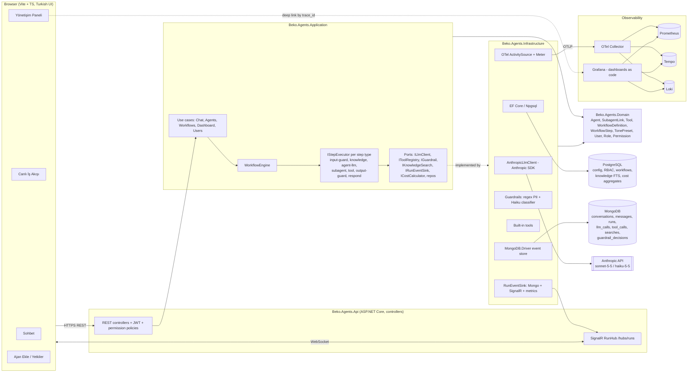

# Planning proposal — Beko AI Agent Platform

Status: **waiting for approval** (no code written yet). Date: 2026-11-03.

## 0. Things I verified (and what changed)

| Topic | Finding | Effect on design |
|---|---|---|
| Anthropic C# SDK | Official package is `Anthropic` on NuGet (v10+; v12.x current, **v13.0.0 switches to API version 2026-10-21**). Has `Messages.Create`, `CreateStreaming` (IAsyncEnumerable), tool use, `IChatClient` adapter, and **built-in OTel spans** via `AddSource("com.anthropic.sdk.csharp*")`. | We call the SDK directly (no Semantic Kernel / Agent Framework layer). We add its ActivitySource so HTTP-level LLM spans come for free; we wrap them in our own `gen_ai.*` spans. Pin the exact version on day 1 after checking NuGet. |
| OTel GenAI conventions | Still "development" status. Agent span: `invoke_agent {gen_ai.agent.name}`; tool span: `execute_tool {gen_ai.tool.name}`; LLM span: `chat {gen_ai.request.model}`. Tool args/results are opt-in attributes. | We use those names and attributes. Full tool inputs/outputs go to MongoDB (not span attributes), linked by `trace_id`/`span_id`. |
| Oracle Always Free A1 | **Halved to 2 OCPU / 12 GB total** (sources say effective June–Aug 2026; not confirmed on an official Oracle page). Pay-as-you-go accounts may still get 4/24. | Everything still fits (budget below), but tightly on CPU. **Question 1.** |
| Workflow designs | Power Automate / Logic Apps store a flow as JSON: `actions` with `runAfter` (predecessor + status), nested `Scope`/`Foreach` containers. n8n/Dify use a node list + edges. | We use the same "definition as data" idea but simpler: ordered steps + nesting (no general DAG). See §3. |
| Logo | `beko-logo.png` is **100% white pixels** on transparent. On a white background it is invisible. | **Question 4.** |
| KACHOW repo | Studied layout: `docs/architecture/{architecture,backend,frontend,ai}.md`, `docs/development/*`, numbered diagrams + `00-index.md`, `AGENTS.md` as single rule source, categorized badge README. | We copy this structure, adapted to .NET. |

## 1. Architecture



### Key design choices
- **One run = one user message.** `WorkflowEngine` loads the agent's current workflow definition (versioned) from Postgres and executes its steps in order. Every step goes through one wrapper that (1) opens an OTel span, (2) writes a Mongo event with `trace_id`/`span_id`, (3) pushes `StepStarted/StepCompleted/StepFailed` over SignalR, (4) records duration, tokens and cost. Because all steps share this wrapper, the claim "we record every step" is true by construction, not by discipline.
- **Agent loop step (`agent.llm`)**: a standard Claude tool-use loop (call → `tool_use` blocks → execute → `tool_result` → repeat until `end_turn`, with a max-iterations cap). Streaming text deltas go to the chat UI.
- **Subagents = agents exposed as tools** to the parent (`delegate_to_{subagent}`). Calling one starts a nested run of that agent's own workflow, with its own `invoke_agent` span as a child. This is the common "agents-as-tools" pattern and it shows naturally as a nested branch in the workflow view.
- **Guardrails**: input = fast regex/checksum PII (TC Kimlik No with checksum, TR IBAN, phone, e-mail) + one Haiku call with structured output classifying `prompt_injection | off_topic | harmful | ok` against the agent's allowed topics. Output = PII redaction + Haiku check for topic/tone/policy. Each decision → Mongo `guardrail_decisions` + metric `guardrail_blocks_total{reason}` + its own span. Off-topic → polite Turkish refusal in the agent's tone.
- **Tone**: `tone_presets` table (resmi / samimi / teknik, editable). Agent has a default; conversation can override. Injected into the system prompt.
- **Knowledge search**: PostgreSQL full-text search (`turkish` config, `tsvector` + GIN) over `knowledge_chunks`. No vector DB (memory budget; Anthropic has no embeddings API). We add `pgvector` later only if the real problem needs semantic search.
- **Cost**: `PricingOptions` (USD per million tokens per model, incl. cache read/write). Each LLM call's cost is stored on the Mongo `llm_calls` doc, added to the step and run, emitted as metric `gen_ai_cost_usd_total{agent,user,model}`, and rolled up into Postgres `cost_daily`.
- **RBAC**: own `users` table (BCrypt) + JWT; `roles` ↔ `permissions` (e.g. `agents.read`, `agents.write`, `chat.use`, `dashboard.read`, `users.manage`); `agent_access` restricts which agents a User may chat with. ASP.NET Core policy per permission. Seeded roles: Admin, AgentBuilder, User, Viewer.
- **Real-time**: SignalR (built into ASP.NET Core; the TS client `@microsoft/signalr` works without a framework). Group per conversation/run.

## 2. Repository structure

```text
backend/
  Beko.Agents.slnx
  Directory.Build.props, Directory.Packages.props   (central package versions)
  src/
    Beko.Agents.Domain/          entities, value objects, enums (no dependencies)
    Beko.Agents.Application/     use cases, DTOs, ports, WorkflowEngine, step executors
    Beko.Agents.Infrastructure/  Persistence/Postgres (EF Core + migrations), Persistence/Mongo,
                                 Llm/Anthropic, Guardrails, Knowledge, Tools, Telemetry, Realtime
    Beko.Agents.Api/             Controllers, Hubs, Auth, Options validation, Program.cs
  tests/
    Beko.Agents.Domain.Tests/  Beko.Agents.Application.Tests/  (xUnit, fake ILlmClient)
    Beko.Agents.Api.IntegrationTests/  (WebApplicationFactory + Testcontainers)
frontend/
  index.html, vite.config.ts, tsconfig.json, package.json, eslint.config.js
  public/brand/beko-logo.png
  src/
    main.ts, router.ts            (tiny hash router, no framework)
    api/        http client, typed DTOs, signalr client
    pages/      login, chat, agents, agent-edit, workflow, dashboard, users
    components/ header, sidebar, step-card, data-table, stat-tile, modal, toast
    styles/     tokens.css (design tokens), base.css, components.css
    i18n/tr.ts  all Turkish strings in one place
deploy/
  docker/      backend.Dockerfile, frontend.Dockerfile (+ nginx.conf), multi-stage, linux/arm64
  kubernetes/  namespace, configmap, secrets.template, postgres, mongodb, backend, frontend,
               ingress (Traefik, built into k3s), monitoring/*
monitoring/
  otel-collector/config.yaml  prometheus/prometheus.yml  tempo/tempo.yaml  loki/loki.yaml
  grafana/provisioning/{datasources,dashboards}/  grafana/dashboards/*.json
docs/
  PROGRESS.md
  architecture/  architecture.md, backend.md, frontend.md, ai.md, contracts.md (REST + SignalR events)
  diagrams/      00-index.md, 01-use-case … 08-mongo-document-model
  development/   coding-standards.md, git-workflow.md, testing.md
  deployment/    oracle-k3s.md (every manual step, exact commands)
  reference/     workflow-reference.png
evaluation/      intents.jsonl, guardrail-attacks.jsonl, tool-use.jsonl + small runner (dotnet test category)
.github/workflows/  ci.yml (PR + dev), deploy.yml (main)
compose.yml, Makefile, .env.example, README.md, CLAUDE.md (imports @AGENTS.md), AGENTS.md
```

## 3. Data-driven workflow: approach

How others do it: Power Automate/Logic Apps store a JSON definition (`actions`, `runAfter`, nested scopes); n8n/Dify store nodes + edges and run a generic executor; LangGraph/Agent Framework compile a graph in code. The common pattern is **definition stored as data + a registry of typed step executors + an engine that interprets the definition**.

Our version (deliberately simpler than a DAG, because the reference UI is a vertical chain):

- Postgres `workflow_definitions(id, agent_id, version, is_active, created_by, created_at)` and `workflow_steps(id, definition_id, parent_step_id NULL, position, type, name, config JSONB)`.
- Step types (each has a JSON config schema and an `IStepExecutor`): `trigger.user_message`, `guard.input`, `knowledge.search`, `agent.llm`, `subagent.call`, `tool.call`, `transform.template`, `guard.output`, `respond`.
- **Editing creates a new version** (copy-on-write) and activates it. Every run stores the version it used, so an old run's view stays correct after edits. This is also a governance point: "who changed the flow, when, and which runs used which version".
- `parent_step_id` gives nesting for subagent branches. When `agent.llm` calls a subagent at runtime, the nested run's steps appear under that branch live.
- The engine validates the definition on save (exactly one trigger first, one respond last, known types, config passes schema).
- UI: **hand-built HTML/CSS cards** (not Cytoscape): this matches the Power Automate reference exactly (dotted background, rounded white cards, icon, title, "⋯" menu, "+" between cards), is easy to animate for live status, and has no extra dependency. Reorder via drag handle or ↑/↓ in the "⋯" menu; click opens a side drawer (inputs/outputs, tool calls, tokens, cost, "Trace'i Grafana'da aç").

## 4. Data model (summary)

PostgreSQL: `users, roles, permissions, role_permissions, user_roles, agents, agent_subagents, tools, agent_tools, agent_access, tone_presets, workflow_definitions, workflow_steps, knowledge_sources, knowledge_chunks, cost_daily, audit_log` (config changes).

MongoDB (every doc has `trace_id`, `span_id`, `conversation_id`, `run_id`, `agent_id`, `user_id`, timestamps):
`conversations, messages, runs (status, workflow_version, totals), run_steps, llm_calls (model, tokens, cost, stop_reason), tool_calls (input, output, error), knowledge_searches (query, hits), guardrail_decisions (stage, verdict, reason, detector, latency)`.

## 5. Memory budget on the VM (target ≤ 12 GB, 2 OCPU)

| Component | Request / Limit |
|---|---|
| k3s server + Traefik + CoreDNS | ~700 MB (not a pod we size) |
| backend (.NET, `DOTNET_GCHeapHardLimit`) | 256 Mi / 768 Mi |
| frontend (nginx static) | 32 Mi / 64 Mi |
| PostgreSQL 17 | 256 Mi / 768 Mi |
| MongoDB 8 (`--wiredTigerCacheSizeGB 0.5`) | 512 Mi / 1 Gi |
| OTel Collector | 96 Mi / 256 Mi |
| Prometheus (7d retention) | 256 Mi / 768 Mi |
| Tempo (local storage, 48h) | 256 Mi / 768 Mi |
| Loki (single binary, 48h) | 192 Mi / 512 Mi |
| Grafana | 128 Mi / 384 Mi |
| **Total limits** | **≈ 6.8 GB** + k3s → fits 12 GB with headroom |

CPU is the tighter resource (2 OCPU). We build images in GitHub Actions, never on the VM.

## 6. Milestones and tasks

Work split for the agent team (each owns its files; no overlap):
- **T-backend** → `backend/`
- **T-frontend** → `frontend/`
- **T-infra** → `deploy/`, `monitoring/`, `.github/`, `compose.yml`, `Makefile`, `.env.example`
- **Me (lead)** → `CLAUDE.md`, `AGENTS.md`, `docs/` (contracts first, so backend and frontend can work in parallel), reviews, integration.

**M1 — Skeleton + pipeline (day 1)**
- Lead: `CLAUDE.md`, `AGENTS.md`, `docs/PROGRESS.md`, `docs/architecture/contracts.md` (REST + SignalR event shapes).
- T-backend: solution with 4 projects + tests, Options with startup validation, `/health` + `/api/version`, OTel wired (traces/metrics/logs → OTLP), EF Core + Mongo connectivity checks.
- T-frontend: Vite + TS + ESLint, design tokens, Beko header + login shell, Turkish strings, calls `/api/version`.
- T-infra: Dockerfiles (arm64), `compose.yml` (all services incl. observability), k8s manifests, `ci.yml`, `deploy.yml` (GHCR + SSH deploy + `kubectl rollout status`), `docs/deployment/oracle-k3s.md`. **Exit: hello world reachable on the VM via the pipeline.**

**M2 — Agent runtime + tracing (day 2)**
- Domain + EF schema + seed (demo agent "Beko Asistan" + subagent "Ürün Uzmanı" + tool `get_product_info` + a few knowledge chunks).
- `AnthropicLlmClient` (streaming, tool use, usage → cost), `WorkflowEngine` + step executors (trigger, knowledge, agent.llm, subagent, tool, respond), `RunEventSink` (Mongo + SignalR + metrics), GenAI spans. Chat endpoint + streaming.
- Unit tests with fake `ILlmClient`. **Exit: a chat produces a full trace in Tempo and all Mongo docs.**

**M3 — Dashboard + live workflow view (day 3)**
- Frontend: chat page (streaming), agent list/detail, live workflow page (cards, statuses bekliyor/çalışıyor/tamamlandı/hata, duration, cost, step drawer), governance dashboard (cost by agent/model/user, tool usage, latency, guardrail decisions, conversation explorer → Grafana link).
- Backend: dashboard query endpoints (Mongo aggregations + `cost_daily`).

**M4 — Governance (day 4)**
- Guardrails (input/output), topic restriction, tone presets + selector, RBAC (JWT, policies, agent access), audit log of config changes, Grafana dashboards as code (LLM cost, latency, guardrails, runtime health).

**M5 — Add-agent screen + workflow editing (day 5, cut first)**
- "Ajan Ekle" form (name, description, instructions, allowed topics, model, tone, tools, subagents). Workflow editor: add/remove/reorder/configure steps, versioning, validation.

**M6 — Docs + demo (day 5–6)**
- Diagrams 00–08 with real names, README (badges, screenshots), `evaluation/` sets + runner, demo script, final deploy.

Never cut: tracing, cost, Mongo event log.

## 7. Decisions from your answers (2026-11-03)

1. **Server**: no VM yet; we create it together. Home region: avoid Frankfurt/Amsterdam (A1 capacity is often exhausted); prefer Milan or Stockholm. Budget stays ≤ 2 OCPU / 12 GB.
2. **Repo is public** → CI uses native `ubuntu-24.04-arm` runners, no QEMU.
3. **No domain** → use the VM's public IP via `<ip>.sslip.io` + Let's Encrypt (cert-manager). Oracle gives the IP, not a domain.
4. **Logo** replaced: blue logo on white (400×283, large padding). Header/login use it on white; I add a trimmed copy for tight spaces and keep the original untouched.
5. **Sign-in**: the Postgres `users` table is the allow-list. Only users in it can log in; Admins add/disable users and assign roles in the UI (Kullanıcılar page). Local e-mail + password (BCrypt) with JWT for now. Auth is built on standard OIDC-ready claims, so Microsoft Entra ID can be added later as a second sign-in button that still checks the same allow-list table.

## 8. Original questions

1. **Server**: Oracle now gives 2 OCPU / 12 GB on Always Free (reportedly). Do you already have the A1 VM? Which shape (OCPU/RAM), and is the account Free or Pay-as-you-go? My plan fits 12 GB; if you only have less, I drop Loki first.
2. **Repo visibility / CI**: Is the GitHub repo public? If yes, I use GitHub's native `ubuntu-24.04-arm` runners (fast arm64 builds). If private, I may need QEMU emulation with buildx (slower, ~3–5× build time).
3. **Domain / TLS**: Do you have a domain to point at the VM? If not, I use `<ip>.sslip.io` with Let's Encrypt via cert-manager (works without buying a domain).
4. **Logo**: the PNG is all white. On white backgrounds it disappears. Options: (a) you provide a blue/dark version for white backgrounds, or (b) I use a Beko-blue header bar and a blue login panel so the white logo sits on blue. Which one?
5. **Sign-in and Teams**: Your notes mention publishing to Teams channels with company permissions. For the hackathon, is local login (seeded demo users, JWT) enough, or do you want Microsoft Entra ID sign-in and/or a Teams channel integration? Entra/Teams costs about a day and needs a tenant you control.
