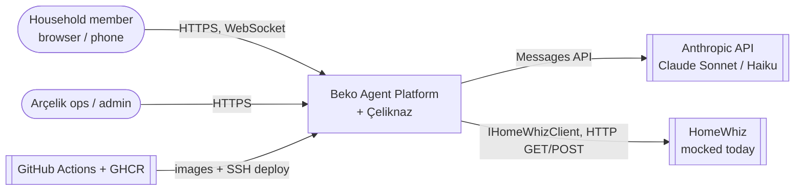
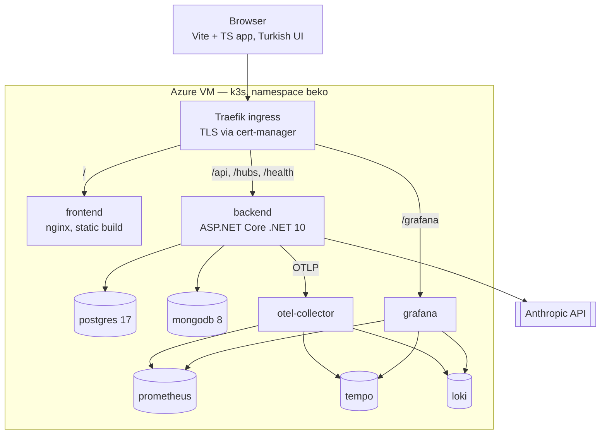
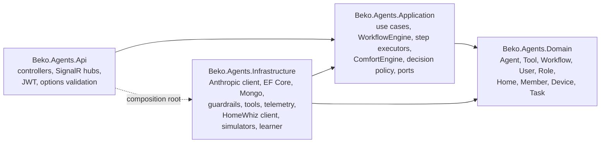
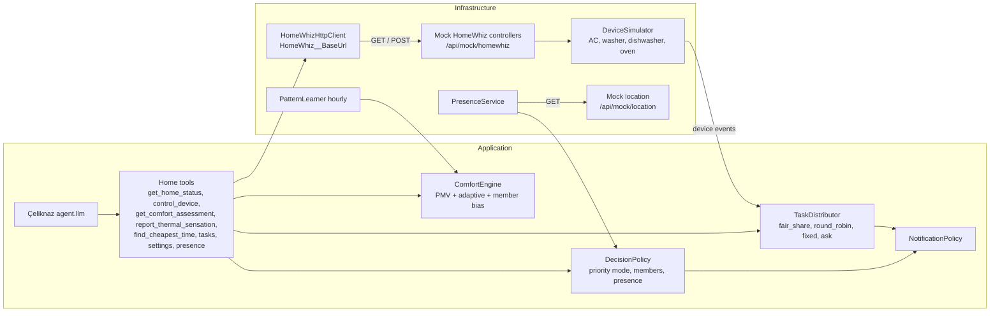
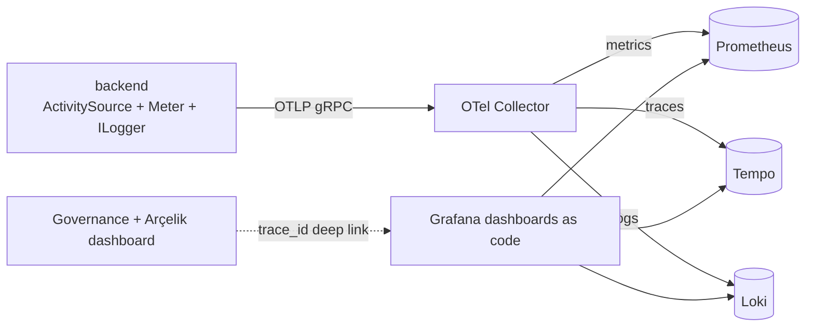

# Architecture

System architecture of the Beko Agent Platform and the Çeliknaz product built on it. Overview: [../overview.md](../overview.md). Diagrams: [../diagrams/00-index.md](../diagrams/00-index.md). Exact API shapes: [contracts.md](contracts.md).

## 1. System context

## 2. Containers (what runs)

All of this runs on **one Azure Linux VM** (Pay-As-You-Go, size to be confirmed, about 4 vCPU / 16 GB) under k3s, and locally with Docker Compose.

Ports, service names and environment variables: [contracts.md](contracts.md).

## 3. Backend layers (Clean Architecture)

| Layer | Contains | Depends on |
|---|---|---|
| Domain | entities, value objects, enums; no packages | nothing |
| Application | use cases, DTOs, **ports** (`ILlmClient`, `IToolRegistry`, `IGuardrail`, `IKnowledgeSearch`, `IRunEventSink`, `ICostCalculator`, `IHomeWhizClient`, repositories), `WorkflowEngine`, `ComfortEngine`, decision and notification policies | Domain |
| Infrastructure | implementations of the ports, background services (`DeviceSimulator`, `PatternLearner`, `PresenceService`), mock HomeWhiz and mock location | Application, Domain |
| Api | controllers, hubs, auth, `Program.cs` | Application (+ Infrastructure for DI) |

## 4. Agent runtime

- **One run = one user message.** `WorkflowEngine` loads the agent's active, versioned workflow from Postgres and runs its steps in order: `trigger.user_message → guard.input → (knowledge.search) → agent.llm → guard.output → respond`.
- **`agent.llm`** is a Claude tool-use loop: call → `tool_use` → execute tool → `tool_result` → repeat until `end_turn` (iteration cap). Text streams to the UI.
- **Subagents are tools** (`delegate_to_{name}`) that start a nested run with its own span.
- **Step wrapper** (the core rule): every step opens an OTel span (`gen_ai.*` names), writes a Mongo document with `trace_id`/`span_id`, pushes a SignalR event and records duration, tokens and cost. Nothing bypasses it, so "we record every step" is true by construction.

Sequence: [../diagrams/03-agent-run-sequence.md](../diagrams/03-agent-run-sequence.md).

## 5. Çeliknaz components

Key rule: **the LLM never computes comfort, patterns or task fairness.** Deterministic C# components do; Claude understands the request, calls tools and explains results. This keeps runs cheap, testable and explainable.

## 6. Data

| Store | Holds | Why |
|---|---|---|
| **PostgreSQL** | configuration and relations: users, roles, permissions, agents, tools, workflows (versioned), tone presets, knowledge (FTS), cost aggregates; homes, members, devices, settings, comfort profiles, routines, schedules, tasks, task rules, energy rollups | transactional, relational, small |
| **MongoDB** | high-volume events: conversations, messages, runs, run steps, LLM calls, tool calls, knowledge searches, guardrail decisions; device events, telemetry, comfort feedback, presence (bands only), task events, notifications | append-heavy, flexible shape; every document has `trace_id` + `span_id` |

Models: [../diagrams/08-er-postgres.md](../diagrams/08-er-postgres.md), [../diagrams/09-mongo-document-model.md](../diagrams/09-mongo-document-model.md).

## 7. Real-time

SignalR, built into ASP.NET Core; the browser uses `@microsoft/signalr` without a framework.

| Hub | Group | Events |
|---|---|---|
| `/hubs/runs` | per conversation / run | step started / completed / failed, text deltas |
| `/hubs/devices` | per home | `DeviceStateChanged`, `DeviceEvent`, `TaskAssigned`, `NotificationCreated`, `ComfortCheckRequested` |

## 8. Observability and cost

- Spans follow OTel GenAI conventions: `invoke_agent {agent}`, `chat {model}`, `execute_tool {tool}`.
- Cost is never hard-coded: `PricingOptions` (LLM), `EnergyOptions` (kWh, tariff bands, device profiles), `InfraCostOptions` (server cost per month).
- Metrics: tokens, `gen_ai_cost_usd_total{agent,user,model}`, latency, tool errors, guardrail blocks, device commands by source, energy, override and feedback rates.

## 9. Security and trust

- Login: `users` table is the allow-list, BCrypt passwords, JWT; permission policies per endpoint; roles Admin, AgentBuilder, User, Viewer; household roles owner, member, guest.
- Guardrails: input (PII regex/checksum + Haiku classifier for injection, off-topic, harmful), output (PII redaction + topic/tone check). Every decision is stored and counted.
- Device safety: bounds and capability checks inside the tools; confirmations for disruptive actions; every automatic action is notified, traced and reversible.
- Privacy: location opt-in, only distance bands stored; "reset what you learned"; secrets only in environment variables / k8s secrets.

## 10. Deployment

- Images: `ghcr.io/mberke1597/beko-backend`, `beko-frontend`, built for `linux/arm64` on native ARM GitHub runners.
- `dev` / PRs: build, lint, test. `main`: build → push to GHCR → SSH to the VM → apply manifests → `kubectl rollout status`.
- Public URL: `https://<label>.<region>.cloudapp.azure.com` (Azure DNS label, fallback sslip.io) with a Let's Encrypt certificate from cert-manager; Traefik routes by path.
- Memory budget: all pods have requests/limits, about 6.8 GB of limits in total (Proposal §5).

Diagram: [../diagrams/07-deployment.md](../diagrams/07-deployment.md).
