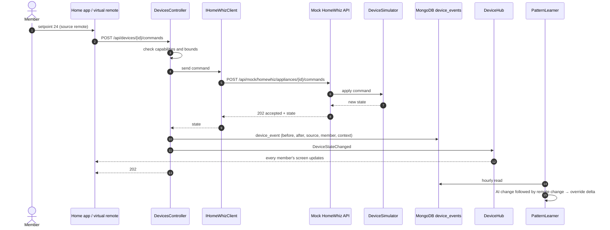

# 04 — Device command (app, remote or AI)

All three sources use the same path, so every change is recorded with its `source`. A remote change shortly after an AI change counts as implicit feedback.

Reading uses only GET: the app and the tools pull `homes`, `rooms` and `appliances` from the mock HomeWhiz through the same client.
