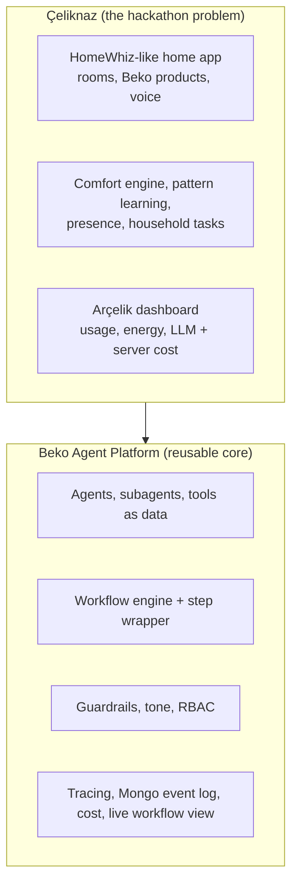

# Project overview — Beko Agent Platform + Çeliknaz

Start here. This page tells the whole story in one place and links to the detailed documents.

| Document | What it covers |
|---|---|
| [architecture/architecture.md](architecture/architecture.md) | System architecture, layers, data, observability, deployment |
| [diagrams/00-index.md](diagrams/00-index.md) | All diagrams (use case, components, sequences, flows, data models, deployment) |
| [architecture/contracts.md](architecture/contracts.md) | REST endpoints, ports, environment variables (source of truth) |
| [../Planning/Celiknaz.md](../Planning/Celiknaz.md) | Full product design of Çeliknaz (comfort engine, learning, tasks, presence, task list) |
| [../Planning/Celiknaz-UI.md](../Planning/Celiknaz-UI.md) | Home app screens: 3 tabs (Evim, Görevler, Asistan), HomeWhiz-style wireframes |
| [../Planning/Proposal.md](../Planning/Proposal.md) / [../Planning/Phases.md](../Planning/Phases.md) | Platform design and execution order |
| [PROGRESS.md](PROGRESS.md) | What is done, in progress, next |

---

## 1. The idea in two sentences

We built (and are building) an **enterprise AI agent platform** in .NET where agents, tools and workflows are data, and every step of every run is traced, logged and costed. On top of it we run **Çeliknaz**, a voice assistant inside a HomeWhiz-compatible Beko home app that manages all Beko products in the home, learns each family member's comfort and habits, shares household tasks fairly, and puts **saving energy and money first**.

## 2. Two layers

- **Platform** (Phases 1–6): reusable for any Beko use case. Nothing in it knows about air conditioners.
- **Çeliknaz** (Phase 7): one agent + home-specific tools, mock HomeWhiz, simulators and UI built on the platform.

## 3. Who uses it

| User | What they do |
|---|---|
| **Household member** (Ayşe, Mehmet, Zeynep) | Sees all Beko products of the home by room, controls them, talks to Çeliknaz, answers "rahat mı?", gets tasks, picks Tasarruf / Dengeli / Konfor and notification level |
| **Arçelik product/ops team** | Watches usage, learning quality, energy saved, LLM cost and server cost per user, scale projection |
| **Agent builder / admin** | Creates and edits agents, tools and workflows in the platform UI; manages users and roles |
| **Viewer / jury** | Reads dashboards and the live workflow view; opens any decision's trace in Grafana |

## 4. What happens when someone speaks

Example: *"Ev soğudu, biraz ısıt."*

1. The browser turns speech into text (Web Speech API, `tr-TR`) and sends it to the chat API.
2. The **workflow engine** runs Çeliknaz's workflow: input guardrail → LLM with tools → output guardrail → answer.
3. Claude decides to call `get_home_status` and `get_comfort_assessment`.
4. The **comfort engine** (plain C#, no LLM) computes how the people in the room feel from temperature, humidity, clothing, season and each member's learned sensitivity, and returns the cheapest action that reaches the comfort band of the chosen priority mode, with its TL cost.
5. Claude calls `control_device`; the call goes through `IHomeWhizClient` to the **mock HomeWhiz** API; the **simulator** changes the AC state.
6. The new state is pushed to the app over SignalR; Çeliknaz answers aloud: *"Salonu 25 dereceye aldım, saatte yaklaşık 1 TL fark eder."*
7. About 20 simulated minutes later the app asks *"Nasıl, rahat mı?"*; the answer (or a correction with the remote) updates that member's profile.
8. Every step above is one OTel span + one Mongo document + one SignalR event + metrics, linked by `trace_id`. The live workflow view lights up step by step and the cost appears on the dashboard.

See [diagrams/03-agent-run-sequence.md](diagrams/03-agent-run-sequence.md).

## 5. The smart parts

| Feature | In one line | Diagram |
|---|---|---|
| Comfort engine | Standard thermal comfort model (PMV + adaptive), humidity-aware, clothing-aware, per-member sensitivity, cheapest action first | [10](diagrams/10-comfort-decision.md) |
| Priority mode | Tasarruf (default) / Dengeli / Konfor with monthly TL estimate; cheap-hour shifting for washer and dishwasher | [10](diagrams/10-comfort-decision.md) |
| Pattern learning | Preferred setpoints by context, routines, overrides, sensitivity; backend computes, LLM explains | [11](diagrams/11-learning-loop.md) |
| Presence | Mock location per member; everyone left the range → off/eco; coming back → pre-condition | [05](diagrams/05-presence-flow.md) |
| Household tasks | Product events create tasks ("Çamaşırları as"), distributed fairly among members at home; rules are configurable | [06](diagrams/06-household-task-flow.md) |
| Conflicts | Two members want different temperatures → Çeliknaz asks; default is compromise | [06](diagrams/06-household-task-flow.md) |
| Notifications | Sessiz / Dengeli / Detaylı, quiet hours, daily cap, learns from ignored prompts | [Celiknaz §14](../Planning/Celiknaz.md) |

## 6. Mock environment

There is no real HomeWhiz or device access during the hackathon, so:

- A **mock home** is seeded: Salon, Yatak odası, Çocuk odası, Mutfak, Çamaşır odası, with ACs, washing machine, dishwasher, oven (fridge optional).
- **Mock HomeWhiz endpoints** (`/api/mock/homewhiz/...`) serve homes, rooms and appliances with **GET**; commands go with one POST. Our app reads them through `IHomeWhizClient` and `HomeWhiz__BaseUrl`, so the real HomeWhiz can replace the mock by configuration.
- **Simulators** move room temperature and humidity, run washer/dishwasher programs, heat the oven, with a faster simulated clock for the demo.
- A **mock location endpoint** returns each member's position on a scripted route (`at_home`, `commute_out`, `commute_back`).
- A **synthetic history generator** creates weeks of behaviour so learning is visible on stage.

## 7. Technology

.NET 10 (ASP.NET Core controllers, Clean Architecture) · official `Anthropic` C# SDK (`claude-sonnet-5-5`, `claude-haiku-5-5`) · Vite + TypeScript, no UI framework, Turkish UI · PostgreSQL + MongoDB · OpenTelemetry → Collector → Prometheus / Tempo / Loki → Grafana · Docker · k3s on one Azure Linux VM (Pay-As-You-Go) · GitHub Actions CI/CD.

## 8. How it reaches people

`git push` to `main` → GitHub Actions builds arm64 images → GHCR → SSH deploy to the Azure VM → k3s rolls out. Users open `https://<label>.<region>.cloudapp.azure.com` (free TLS by Let's Encrypt) and sign in with accounts an admin added to the `users` table. See [diagrams/07-deployment.md](diagrams/07-deployment.md).

## 9. Why the jury should care

| Criterion | Answer |
|---|---|
| User impact | One voice for every Beko product; learns *you*; fair task sharing; fewer corrections over time |
| Agent effectiveness | Deterministic engines + LLM for language; bounded tools; evaluation sets; measurable override and "İyi" rates |
| Innovation | Thermal comfort science + implicit feedback from the physical remote + presence + household tasks, all in one assistant |
| Business value | Plugs into HomeWhiz; TL and kWh saved per home × fleet; unit cost per user; new products are configuration |
| AI safety and trust | Every decision traced and explainable, hard device bounds, confirmations, guardrails, KVKK-friendly location, "reset what you learned" |
